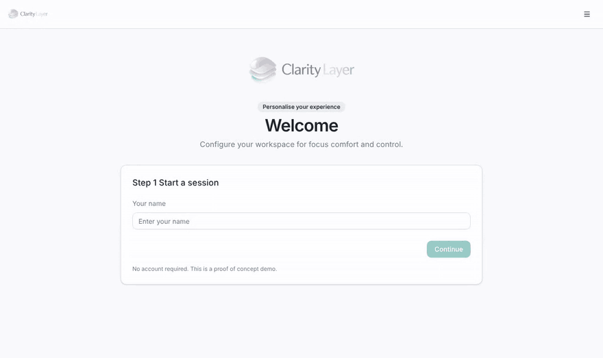
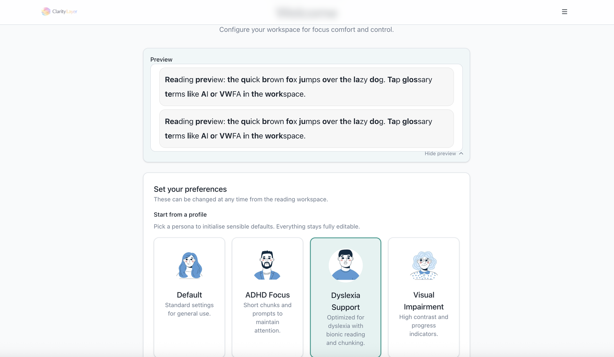
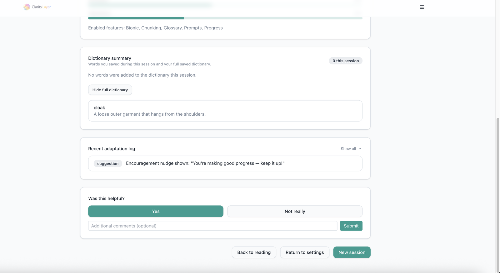
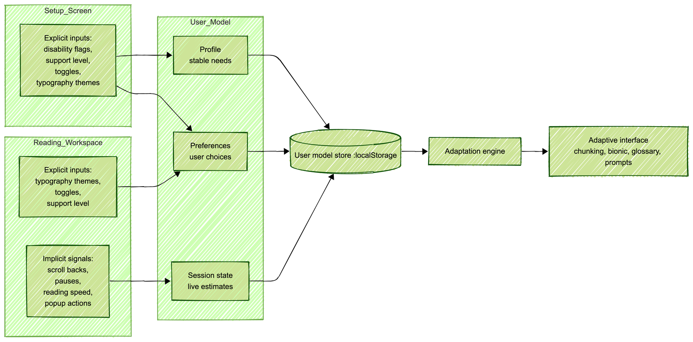

<p align="center">
  
</p>

<p align="center"><strong>An adaptive reading workspace that explains every change it makes.</strong></p>

<p align="center">
  <a href="https://github.com/leahweldon/Clarity-Layer/actions/workflows/build.yml"></a>
  
  
  
</p>

<p align="center">
  
</p>

<p align="center"><em>A short session: pick the Dyslexia Support persona, read with bionic emphasis and chunking, look up a glossary term, reread a passage and watch the system adapt, undo it, then check the <strong>Why</strong> log and the session summary. Sped up, with a short idle wait trimmed.</em></p>

Reading tools tend to offer a zoom button and a dark mode, and leave the reader to fix everything else. Clarity Layer adapts how a document is presented (chunking dense passages, bionic emphasis, glossary support, typography) based on the reader's stated preferences and simple behavioural signals like rereading and long pauses. The defining constraint is **scrutability**: every adaptation is logged, explained in plain language and reversible.

Built by Team Kojack for CS7IS5 Adaptive Applications at Trinity College Dublin (2026).

## Features



- **Onboarding with persona presets:** Default, ADHD Focus, Dyslexia Support and Visual Impairment profiles solve the cold-start problem; every setting stays editable, with a live preview.
- **Adaptive reading aids:** chunking, bionic reading, glossary highlighting with a personal dictionary, and font size, spacing, line width and theme controls.
- **Behavioural signals:** scroll-backs of more than 60px count as rereads and three minutes of inactivity as a long pause. Both feed context-sensitive suggestions, with cooldowns tied to the chosen support level.
- **Scrutability panel:** *Your Model* shows what the system believes, *Why* logs every adaptation (labelled info, suggestion or auto), and *Controls* lets the reader override anything or lock the layout entirely.
- **Session summary:** reading time, adjustments, model changes, saved vocabulary and an exportable adaptation log.
- **Documents and accounts:** paste text or upload a PDF; Clerk sign-in links preferences and saved documents to an account.



## How it works

The user model has three layers, kept separate so the interface can always show what the reader *chose* versus what the system *inferred*:

| Layer | Holds | Source |
|---|---|---|
| **Preferences** | Reading goal, support level, accessibility settings, enabled features | Explicit: onboarding and controls |
| **Inferred support** | Sections flagged as difficult, inferred feature preferences | Derived from behaviour |
| **Session interaction** | Reading time, scroll-backs, pauses, feature toggles | Observed live, reset each session |



Adaptation is deliberately **rule-based rather than learned**, so every decision can be explained: each prompt traces back to a specific trigger, and the *Why* panel always has a concrete answer to show.

**Evaluation (scenario-based):** adaptive prompts triggered correctly in 5 of 5 scenarios, accepted prompts updated the user model in the same render cycle, all 4 persona presets applied the correct configuration, and Layout Lock suppressed 100% of prompts.

## Tech stack

React 19 · TypeScript · Vite 7 · Tailwind CSS · shadcn/ui and Radix UI · React Router · Clerk · PDF.js · `localStorage` for preferences, with session state held in React Context.

## Getting started

Requires Node.js 20.19+ or 22.12+ and a free [Clerk](https://clerk.com) application.

```bash
cd app
cp .env.example .env.local   # add your Clerk publishable key
npm install
npm run dev
```

Then open http://localhost:5173. [`app/CLERK_SETUP.md`](app/CLERK_SETUP.md) walks through the Clerk configuration.

## Project structure

```text
app/src/
├── features/
│   ├── onboarding/     # Persona presets, preferences, live preview
│   ├── documents/      # Paste, PDF upload, history
│   ├── reader/         # Reader, content pane, adaptive prompts, nudges, side panel, glossary
│   ├── summary/        # Session summary and adaptation log
│   ├── personas/
│   └── auth/           # Clerk sign-in and protected routes
├── shared/
│   ├── state/          # AppContext: the user model
│   ├── layout/
│   └── api/
└── components/ui/      # shadcn/ui components
```

## Team

**Tanmay Birari · Liam Byrne · Petra Marcokova · Martha Ryan · Leah Weldon**. See [CONTRIBUTIONS.md](CONTRIBUTIONS.md) for who built what.

**My contribution (Leah Weldon):** the concept grew out of my own experience as a reader, and I pushed for the transparent, rule-based design early on. I set up the repository and built the front-end proof of concept the team developed on (onboarding, document input, the reading workspace and the scrutability side panel), then refined the reader layout, progress tracking and theming.

## Report

The full project report covers the user model, use cases, architecture, adaptive approach and evaluation: **[Clarity-Layer-Final-Report.pdf](docs/Clarity-Layer-Final-Report.pdf)**
